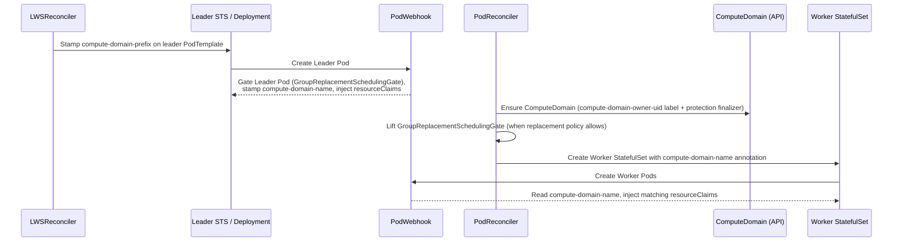

# KEP-1259: Automatic ComputeDomain Lifecycle Management for MNNVL

<!-- toc -->
- [Summary](#summary)
- [Motivation](#motivation)
  - [Goals](#goals)
  - [Non-Goals](#non-goals)
- [Proposal](#proposal)
  - [User Stories](#user-stories)
    - [Story 1: Standalone LeaderWorkerSet with Multi-Node Collectives](#story-1-standalone-leaderworkerset-with-multi-node-collectives)
    - [Story 2: DisaggregatedSet with Cross-Role NVLink KV-Cache Transfer](#story-2-disaggregatedset-with-cross-role-nvlink-kv-cache-transfer)
    - [Story 3: DisaggregatedSet with Intra-Role MNNVL and RDMA KV Transfer](#story-3-disaggregatedset-with-intra-role-mnnvl-and-rdma-kv-transfer)
    - [Story 4: Multimodal DisaggregatedSet with Role Opt-Out](#story-4-multimodal-disaggregatedset-with-role-opt-out)
  - [Notes/Constraints/Caveats](#notesconstraintscaveats)
  - [Risks and Mitigations](#risks-and-mitigations)
- [Design Details](#design-details)
  - [Feature Gate, Configuration, and RBAC](#feature-gate-configuration-and-rbac)
  - [Annotations and Precedence](#annotations-and-precedence)
    - [User-Facing Annotations](#user-facing-annotations)
    - [Controller-Internal Metadata (Annotations, Labels, and Finalizer)](#controller-internal-metadata-annotations-labels-and-finalizer)
    - [Effective Scope Resolution Matrix on DisaggregatedSet](#effective-scope-resolution-matrix-on-disaggregatedset)
  - [ComputeDomain Resource Shape and Naming](#computedomain-resource-shape-and-naming)
    - [Generated ComputeDomain Spec](#generated-computedomain-spec)
    - [Naming and Length Bounds](#naming-and-length-bounds)
  - [Lifecycle Reconciliation and Ordering](#lifecycle-reconciliation-and-ordering)
    - [Option 1: Per-Replica Mode (LeaderWorkerSet)](#option-1-per-replica-mode-leaderworkerset)
    - [Option 2: Per-(slice, revision) Mode (DisaggregatedSet)](#option-2-per-slice-revision-mode-disaggregatedset)
    - [Deferred Deletion, Workload Teardown, and Finalizer Release](#deferred-deletion-workload-teardown-and-finalizer-release)
  - [Pod Claim Injection and GPU Container Detection](#pod-claim-injection-and-gpu-container-detection)
  - [Update and Rollout Semantics](#update-and-rollout-semantics)
  - [Validation](#validation)
  - [Caching and API Server Performance](#caching-and-api-server-performance)
  - [Relationship and Migration Path to Upstream PodGroup DRA (KEP-5729)](#relationship-and-migration-path-to-upstream-podgroup-dra-kep-5729)
  - [Test Plan](#test-plan)
      - [Prerequisite testing updates](#prerequisite-testing-updates)
      - [Unit tests](#unit-tests)
      - [Integration tests](#integration-tests)
      - [e2e tests](#e2e-tests)
  - [Graduation Criteria](#graduation-criteria)
    - [Alpha (v0.12)](#alpha-v012)
    - [Beta](#beta)
    - [Stable / Deprecation](#stable--deprecation)
- [Implementation History](#implementation-history)
- [Drawbacks](#drawbacks)
- [Alternatives](#alternatives)
  - [Alternative 1: Single Workload-Wide ComputeDomain (Grove Model)](#alternative-1-single-workload-wide-computedomain-grove-model)
  - [Alternative 2: Typed Fields on LeaderWorkerSetSpec and DisaggregatedSetSpec](#alternative-2-typed-fields-on-leaderworkersetspec-and-disaggregatedsetspec)
  - [Alternative 3: Make auto-compute-domain Annotations Immutable](#alternative-3-make-auto-compute-domain-annotations-immutable)
  - [Alternative 4: External Companion Controller + Webhook](#alternative-4-external-companion-controller--webhook)
  - [Alternative 5: Wait for Upstream PodGroup-Scoped DRA (KEP-5729)](#alternative-5-wait-for-upstream-podgroup-scoped-dra-kep-5729)
<!-- /toc -->

## Summary

Multi-Node NVLink (MNNVL) systems such as NVIDIA GB200 and GB300 NVL72 racks
require participating pods to join a shared Internode Memory Exchange (IMEX)
domain managed through an NVIDIA Dynamic Resource Allocation (DRA)
`ComputeDomain` (`resource.nvidia.com/v1beta1`) custom resource and its
generated `ResourceClaimTemplate`. Today, because `LeaderWorkerSet` and
`DisaggregatedSet` pod templates are static across replicas, slices, and
revisions, users must manually create a single static `ComputeDomain` shared by
an entire deployment, breaking GPU memory isolation across replicas and slices
and mixing revisions during rolling updates.

This KEP introduces opt-in, feature-gated automatic `ComputeDomain` lifecycle
management and pod `resourceClaims` injection across `LeaderWorkerSet` and
`DisaggregatedSet` via annotations, keeping core APIs vendor-neutral while
supporting the two MNNVL scoping granularities needed by distributed inference
workloads:

1. **Per `LeaderWorkerSet` replica** (isolated per revision and replica
   incarnation), for intra-replica multi-node collectives (TP / PP / Wide-EP)
   in standalone `LeaderWorkerSet`s or individual `DisaggregatedSet` roles.
2. **Per `DisaggregatedSet` `(slice, revision)`**, for cross-role MNNVL
   communication (such as `prefill` to `decode` KV-cache transfer over NVLink
   `cuda_ipc` / NIXL alongside intra-role collectives) within each slice, with
   per-role opt-out support.

## Motivation

On MNNVL hardware (such as GB200/GB300 NVL72), GPUs across up to 18 compute
nodes share high-bandwidth NVLink fabric memory (`CU_MEM_HANDLE_TYPE_FABRIC`).
Cross-node GPU memory import/export is gated at the OS and driver level by
NVIDIA IMEX daemons and `/dev/nvidia-caps-imex-channels/channelN` capability
devices. In Kubernetes, the NVIDIA DRA driver (`k8s-dra-driver-gpu`) provisions
an IMEX domain and channel per `ComputeDomain` CR:

1. An operator or controller creates a `ComputeDomain` CR specifying
   `spec.channel.resourceClaimTemplate.name` (with `spec.numNodes: 0` for
   elastic membership under `IMEXDaemonsWithDNSNames`).
2. The NVIDIA DRA controller creates the corresponding `ResourceClaimTemplate`.
3. Every participating pod references that `ResourceClaimTemplate` in
   `pod.spec.resourceClaims` and attaches the claim in `container.resources.claims`
   on its GPU containers.

Without first-class lifecycle integration in LWS, users face three problems:

1. **No isolation across replicas or slices.** All replicas of a
   `LeaderWorkerSet` and all slices of a `DisaggregatedSet` are stamped from a
   single `PodTemplateSpec`. Referencing a static `resourceClaimTemplateName`
   places independent replicas or slices into one shared IMEX domain, violating
   least-privilege GPU memory isolation, widening the IMEX daemon blast radius,
   and running into NVLink clique boundaries when replicas span multiple racks.
2. **Cross-revision contamination during rollouts.** During a rolling update
   (`maxSurge > 0` or partitioned rollouts), surging new-revision pods and
   draining old-revision pods share the same `ComputeDomain` unless each
   revision receives its own isolated domain.
3. **Manual lifecycle toil.** Operators must create, name, and garbage-collect
   `ComputeDomain` objects out of band instead of having them scale
   automatically with `LeaderWorkerSet.spec.replicas`,
   `DisaggregatedSet.spec.slices`, rolling updates, and workload deletion.

Other orchestrators in the ecosystem (such as
[Grove's `auto-mnnvl`](https://github.com/ai-dynamo/grove/blob/main/docs/user-guide/auto-mnnvl.md))
automate `ComputeDomain` creation, but only at a single monolithic workload
granularity without revision isolation or the two-level distinction between
per-replica intra-role MNNVL and per-slice cross-role MNNVL. Meanwhile, although upstream `PodGroup`-scoped DRA `ResourceClaim`s
([KEP-5729](https://github.com/kubernetes/enhancements/issues/5729), Beta and
default-disabled behind `DRAWorkloadResourceClaims` in Kubernetes 1.37) and
shared leaf-group claims in `spec.scheduling`
([KEP-666](/keps/666-gang-scheduling-in-lws)) exist at the scheduling API layer,
`k8s-dra-driver-gpu`
([dra-driver-nvidia-gpu#934](https://github.com/kubernetes-sigs/dra-driver-nvidia-gpu/issues/934))
still provisions MNNVL IMEX domains exclusively through `ComputeDomain` CRs, and
upstream `PodGroup` claims attach only to leaf `PodGroup`s rather than
cross-role `DisaggregatedSet` slices or composite groups.

### Goals

1. Automatically create, manage, protect while pods reference it, and clean up
   `ComputeDomain` (`resource.nvidia.com/v1beta1`) resources for opted-in
   `LeaderWorkerSet` and `DisaggregatedSet` workloads.
2. Support **replica-scoped** `ComputeDomain`s on `LeaderWorkerSet` (including
   individual `DisaggregatedSet` roles) with isolation across replicas,
   revisions, and in-place replica restarts, for both `Ordinal` and `Hash`
   `groupIdentity` modes.
3. Support **`(slice, revision)`-scoped** `ComputeDomain`s on
   `DisaggregatedSet`, enrolling participating roles within each slice while
   allowing individual roles to opt out or use replica-scoped domains instead.
4. Automatically inject pod-level and container-level DRA `resourceClaims` into
   GPU containers while skipping CPU-only sidecar containers (such as
   `routing-proxy`).
5. Keep the core `LeaderWorkerSet` and `DisaggregatedSet` CRD schemas
   vendor-neutral, add zero third-party Go module dependencies to `lws`, and
   require zero NVIDIA CRDs or RBAC permissions when the feature is disabled.

### Non-Goals

1. Adding NVIDIA-specific fields to `LeaderWorkerSetSpec` or
   `DisaggregatedSetSpec`.
2. Installing or managing the NVIDIA DRA driver or `ComputeDomain` CRD itself.
3. Automatically injecting node-topology placement rules (`nvidia.com/gpu.clique`)
   when `auto-compute-domain` is enabled; topology placement remains orthogonal
   and configured via `spec.placementPolicy` ([KEP-848](/keps/848-disaggregatedset-placement-policy),
   [KEP-1064](/keps/1064-lws-placement-policy)), `spec.scheduling`
   ([KEP-666](/keps/666-gang-scheduling-in-lws)), or Kueue TAS.
4. Supporting legacy fixed-node `ComputeDomain` mode (`spec.numNodes > 0`);
   this KEP targets elastic `ComputeDomain`s (`spec.numNodes: 0`), which has
   been the default in `k8s-dra-driver-gpu` since `IMEXDaemonsWithDNSNames`
   graduated to default-enabled.
5. Defining multiple arbitrary cross-role MNNVL subsets within the same
   `DisaggregatedSet` slice in Alpha (beyond opting specific roles out or into
   replica-level scope).

## Proposal

Introduce an Alpha feature gate `AutoComputeDomain` (disabled by default) and
two resource-scoped annotations following LWS and DisaggregatedSet naming
conventions:

- `leaderworkerset.sigs.k8s.io/auto-compute-domain: "enabled" | "disabled"`
  on `LeaderWorkerSet` (or `DisaggregatedSet.spec.roles[i].metadata.annotations`):
  manages one `ComputeDomain` per active `LeaderWorkerSet` replica (isolated per
  revision and replica restart incarnation) and injects its claim into the
  replica's leader and worker GPU containers.
- `disaggregatedset.x-k8s.io/auto-compute-domain: "enabled" | "disabled"`
  on `DisaggregatedSet` (with optional `"disabled"` override on
  `DisaggregatedSet.spec.roles[i].metadata.annotations`): manages one
  `ComputeDomain` per active `(slice, revision)` of the `DisaggregatedSet` and
  injects its claim into GPU containers of all non-opted-out roles in that
  slice.

Enabling, disabling, or changing role participation rolls out safely through a
new workload revision rather than requiring workload deletion and recreation.

### User Stories

#### Story 1: Standalone LeaderWorkerSet with Multi-Node Collectives

A platform engineer deploys DeepSeek-R1 across 2 replicas (`replicas: 2`,
`size: 4`, 4 GPUs/pod = 16 GPUs/replica) on GB200 NVL72 racks using
`spec.placementPolicy` (`ExclusiveTopology: nvidia.com/gpu.clique`) and sets
`leaderworkerset.sigs.k8s.io/auto-compute-domain: "enabled"`. LWS creates a
dedicated `ComputeDomain` for replica `0` and another for replica `1`, injects
the matching `resourceClaimTemplateName` into each replica's GPU containers
while skipping the CPU-only `routing-proxy` sidecar, and creates isolated
new-revision `ComputeDomain`s during rolling updates before cleaning up drained
ones.

#### Story 2: DisaggregatedSet with Cross-Role NVLink KV-Cache Transfer

An inference team deploys a `DisaggregatedSet` with `spec.slices: 2`,
`spec.placementPolicy` (`ExclusiveSlice` on `nvidia.com/gpu.clique`), a
multi-node `prefill` role, and a multi-node `decode` role that transfer KV
cache directly over NVLink (`cuda_ipc` via NIXL). They set
`disaggregatedset.x-k8s.io/auto-compute-domain: "enabled"` on the
`DisaggregatedSet`. The controller creates one `ComputeDomain` per
`(slice, revision)` so `prefill` and `decode` pods within slice `0` share one
IMEX domain and pods within slice `1` share a separate IMEX domain. During a
coordinated rolling update, the surging revision receives its own per-slice
`ComputeDomain`s without interfering with the draining revision.

#### Story 3: DisaggregatedSet with Intra-Role MNNVL and RDMA KV Transfer

An inference team runs a `DisaggregatedSet` where `prefill` (`size: 2`) and
`decode` (`size: 4`) span multiple racks and transfer KV cache over
InfiniBand/RoCE RDMA, while each role replica uses MNNVL internally for TP/EP.
They set `leaderworkerset.sigs.k8s.io/auto-compute-domain: "enabled"` on
`spec.roles[prefill].metadata.annotations` and
`spec.roles[decode].metadata.annotations` (leaving the top-level
`DisaggregatedSet` annotation unset). Each generated child `LeaderWorkerSet`
(`<dset>-<slice>-<rev>-<role>`) manages one `ComputeDomain` per role replica.

#### Story 4: Multimodal DisaggregatedSet with Role Opt-Out

A multimodal `DisaggregatedSet` runs `encoder` (single-node vision encoder
outside the NVLink domain), `prefill`, and `decode` (sharing MNNVL within each
slice). The operator sets
`disaggregatedset.x-k8s.io/auto-compute-domain: "enabled"` on the
`DisaggregatedSet` and
`disaggregatedset.x-k8s.io/auto-compute-domain: "disabled"` on the `encoder`
role. Only `prefill` and `decode` enroll in the slice `ComputeDomain`.

### Notes/Constraints/Caveats

- **NVLink topology alignment and node-disjoint domain placement at the scheduling layer.**
  An IMEX channel only connects GPUs within the same physical NVLink clique
  (typically labeled `nvidia.com/gpu.clique`), and in `k8s-dra-driver-gpu`'s
  `driverManaged` mode the kubelet plugin enforces at most **one active
  `ComputeDomain` per node** even when a node has free GPUs. Operators must pair
  `auto-compute-domain` with placement constraints (such as
  `spec.placementPolicy`, WAS `PodGroup` topology constraints, or Kueue TAS) so
  all pods enrolled in a single `ComputeDomain` land within the same NVLink
  clique while distinct `ComputeDomain`s (separate replicas, separate role-level
  domains, or surging revisions) do not share nodes. Rolling updates with
  `maxSurge > 0` and in-place group restarts require spare nodes in the clique,
  or `maxSurge: 0` drain-before-reuse when all clique nodes are occupied.
- **`k8s-dra-driver-gpu` driver mode prerequisite.** LWS creates elastic
  `ComputeDomain`s (`spec.numNodes: 0`), which require `k8s-dra-driver-gpu`
  configured in its default `driverManaged` IMEX mode with
  `IMEXDaemonsWithDNSNames` enabled (`hostManaged` IMEX mode and disabled
  `IMEXDaemonsWithDNSNames` are unsupported). Startup and admission checks
  verify `ComputeDomain` (`v1beta1`) CRD availability via `RESTMapper` without
  reading cross-namespace driver deployments.
- **Asynchronous `ResourceClaimTemplate` creation.** When LWS creates a
  `ComputeDomain`, the NVIDIA DRA controller asynchronously creates the backing
  `ResourceClaimTemplate`. Standard Kubernetes DRA (`ResourceClaimController`
  and `DynamicResources` scheduler plugin) holds pods unscheduled until the
  referenced `ResourceClaimTemplate` and generated pod `ResourceClaim` exist;
  no polling of `ResourceClaimTemplate` by LWS is required, eliminating any
  RBAC need on `resource.k8s.io/resourceclaimtemplates`.
- **Single IMEX channel per pod.** NVIDIA DRA supports one IMEX channel per pod
  compute domain. Enabling both slice-level and replica-level
  `auto-compute-domain` on the same role is rejected at admission unless the
  role explicitly opts out of the slice-level domain.

### Risks and Mitigations

**Risk**: Premature `ComputeDomain` deletion during scale-down, rolling updates,
group restarts, or parent workload teardown tears down the IMEX `DaemonSet` and
`ResourceClaimTemplate` while running or draining pods still need IMEX (in
`k8s-dra-driver-gpu`, `compute-domain-controller` tears down the IMEX
`DaemonSet` as soon as `ComputeDomain.metadata.deletionTimestamp` is set, while
finalizers only hold etcd removal and kubelet directory cleanup).

**Mitigation**: LWS never deletes a managed `ComputeDomain` while any `Pod` in
the namespace references its `resourceClaimTemplateName` (checked in $O(1)$ via
a cached `Pod` field index). Managed `ComputeDomain`s intentionally carry no
`ownerReferences` — recording the managing workload's UID in the
`leaderworkerset.sigs.k8s.io/compute-domain-owner-uid` label instead — so
deleting a `LeaderWorkerSet` or `DisaggregatedSet` does not let Kubernetes
garbage collection mark its `ComputeDomain`s terminating while pods drain. Once
a replica, slice, or parent workload is gone and zero `Pod`s reference the
`ComputeDomain`, LWS removes the protection finalizer
(`leaderworkerset.sigs.k8s.io/compute-domain-protection`) and deletes the
`ComputeDomain`. If a `ComputeDomain` is deleted directly out of band or via
`Namespace` deletion (`deletionTimestamp` already set, which immediately tears
down the IMEX `DaemonSet` in `k8s-dra-driver-gpu`), the protection finalizer
holds etcd object removal and name reuse until all referencing pods exit, after
which LWS releases the finalizer and recreates the domain if an active slice or
replacement group still requires it.

**Risk**: Using `unstructured.Unstructured` with `controller-runtime`'s default
cache settings can bypass the informer cache and issue uncached `GET`/`LIST`
calls to `kube-apiserver` on every reconcile.

**Mitigation**: Register a minimal internal typed `ComputeDomain` object in
`pkg/computedomain` (only the `spec.numNodes`, `spec.channel`, and `ObjectMeta`
fields needed by LWS, with zero external module imports) in the manager's
`runtime.Scheme`. All `Get`/`List` operations — including workload-deletion
checks in `computedomain.Reconciler` — hit local informer caches with zero
uncached API server requests.

**Risk**: Replica restart (`RecreateGroupOnPodRestart`) recreates a leader pod
while a previous worker pod on an unresponsive node is still terminating and
holding the old `ComputeDomain`.

**Mitigation**: Just as `KubernetesProvider` stamps a per-incarnation token for
ordinal `PodGroup`s ([KEP-666](/keps/666-gang-scheduling-in-lws)), the pod
mutating webhook draws an idempotent incarnation suffix when stamping every
leader pod's `ComputeDomain` name at admission (in both `Ordinal` and `Hash`
modes). A restarted group receives a fresh `ComputeDomain` immediately while
the old incarnation's `ComputeDomain` stays alive until its last pod exits.

**Risk**: Core LWS deployments in clusters without NVIDIA GPUs or DRA drivers
fail to start due to missing CRDs or extra RBAC permissions.

**Mitigation**: `AutoComputeDomain` defaults to `false`, and Helm RBAC rules
for `resource.nvidia.com` are rendered only when
`.Values.computeDomainManagement.enabled` or
`.Values.featureGates.AutoComputeDomain` is `true` (mirroring
`.Values.gangSchedulingManagement`). When enabled, the manager verifies via
`RESTMapper` at startup (and on new opt-ins at admission) that
`computedomains.resource.nvidia.com` (`v1beta1`) is served and fails fast with
a clear error if absent.

## Design Details

### Feature Gate, Configuration, and RBAC

Add an Alpha feature gate in `pkg/features/features.go`:

```go
// AutoComputeDomain enables automatic lifecycle management and pod claim
// injection for NVIDIA DRA ComputeDomain resources.
// owner: @ahg-g
// alpha: v0.12
AutoComputeDomain featuregate.Feature = "AutoComputeDomain"
```

Registered in `defaultFeatureGates` as `{Default: false, PreRelease: featuregate.Alpha}`.

In `charts/lws/values.yaml` and `hack/processing-plan.yaml`, add an opt-in
Helm section mirroring `gangSchedulingManagement`:

```yaml
computeDomainManagement:
  # Enables RBAC permissions for managing ComputeDomain resources
  # (computedomains.resource.nvidia.com). Also requires enabling the
  # AutoComputeDomain feature gate while in Alpha.
  enabled: false
```

When `computeDomainManagement.enabled: true` (or
`featureGates.AutoComputeDomain: true`), `hack/processing-plan.yaml` appends
the following rules to the generated manager `ClusterRole`:

```yaml
- apiGroups:
    - resource.nvidia.com
  resources:
    - computedomains
  verbs:
    - create
    - delete
    - get
    - list
    - patch
    - update
    - watch
- apiGroups:
    - resource.nvidia.com
  resources:
    - computedomains/finalizers
  verbs:
    - update
```

For non-Helm installations (`config/default`), provide an opt-in Kustomize
component under `config/components/computedomain` (commented out by default in
`config/default/kustomization.yaml`, mirroring `config/components/volcano`) that
patches `manager-role` with the same `resource.nvidia.com` rules while keeping
default generated manifests in `config/rbac/role.yaml` free of vendor CRDs.

At manager startup, when `features.Enabled(features.AutoComputeDomain)` is
`true`, `cmd/main.go` checks `mgr.GetRESTMapper().RESTMapping(schema.GroupKind{Group: "resource.nvidia.com", Kind: "ComputeDomain"}, "v1beta1")`.
If no mapping exists, startup fails fast with a descriptive error. When the
feature gate is `false`, no `ComputeDomain` watches, field indexes, or
reconcilers are registered, new opt-ins (`CREATE` or newly enabled on `UPDATE`)
are rejected at admission while pre-existing opted-in objects remain updatable,
running pod templates are left unchanged so active groups do not restart, and
`DisaggregatedSet` refuses to create new enrolled child `LeaderWorkerSet`s
without claims alongside already-claimed slices. Because managed
`ComputeDomain`s carry `leaderworkerset.sigs.k8s.io/compute-domain-protection`
without `ownerReferences`, operators disabling `AutoComputeDomain` (or
uninstalling the controller) must first disable `auto-compute-domain` on
opted-in workloads (rolling them out to a non-MNNVL revision) or delete those
workloads and wait for referencing pods to exit so `computedomain.Reconciler`
releases the finalizer and deletes all managed `ComputeDomain`s before flipping
the gate off; otherwise remaining `ComputeDomain`s retain the protection
finalizer (blocking subsequent namespace/object removal until manually cleared)
and replica-mode replacements no longer inject claims.

### Annotations and Precedence

#### User-Facing Annotations

| Annotation Key | Target Object(s) | Allowed Values | Meaning |
| --- | --- | --- | --- |
| `leaderworkerset.sigs.k8s.io/auto-compute-domain` | `LeaderWorkerSet.metadata.annotations`, `DisaggregatedSet.spec.roles[i].metadata.annotations` | `"enabled"`, `"disabled"` | When `"enabled"`, `LeaderWorkerSet` manages one `ComputeDomain` per replica (isolated per revision and incarnation). `"disabled"` or unset disables replica-level management. |
| `disaggregatedset.x-k8s.io/auto-compute-domain` | `DisaggregatedSet.metadata.annotations`, `DisaggregatedSet.spec.roles[i].metadata.annotations` | `"enabled"`, `"disabled"` | When `"enabled"` on `DisaggregatedSet`, manages one `ComputeDomain` per `(slice, revision)` and enrolls all roles whose role-level value is not `"disabled"`. Setting `"enabled"` on a role alone without `"enabled"` on the parent `DisaggregatedSet` is rejected. |
| `leaderworkerset.sigs.k8s.io/compute-domain-containers` | `PodTemplateSpec.metadata.annotations` (`leaderTemplate`, `workerTemplate`) | Comma-separated container names (e.g., `"vllm,worker"`) | Optional explicit list of containers (in `containers` or restartable `initContainers`) to receive the `ComputeDomain` claim instead of auto-detecting via `nvidia.com/gpu`. Needed when GPUs themselves are allocated via DRA `ResourceClaim`s rather than `nvidia.com/gpu` extended resources. |

Using `"enabled"` / `"disabled"` rather than boolean strings follows Kubernetes
API conventions and preserves forward compatibility if named domain groups
within a slice are ever introduced later.

#### Controller-Internal Metadata (Annotations, Labels, and Finalizer)

| Key | Target | Purpose |
| --- | --- | --- |
| `leaderworkerset.sigs.k8s.io/compute-domain-prefix` | Managed leader `PodTemplateSpec` | Stamped by `LeaderWorkerSetReconciler` when replica-level `auto-compute-domain` is active for the revision; carries `<lwsName>-<uid5>` so `PodWebhook` can derive collision-free `ComputeDomain` names synchronously without API calls. |
| `leaderworkerset.sigs.k8s.io/compute-domain-name` | Leader `Pod` and worker `StatefulSet` `PodTemplateSpec` | Stamped idempotently on the leader `Pod` by `PodWebhook` and copied onto the worker `StatefulSet` `PodTemplateSpec` by `PodReconciler` so all pods of the replica join the exact same `ComputeDomain`. |
| `leaderworkerset.sigs.k8s.io/compute-domain-owner-uid` | `ComputeDomain.metadata.labels` | Records the `metadata.uid` of the managing `LeaderWorkerSet` or `DisaggregatedSet`. Replaces `ownerReferences` so Kubernetes garbage collection does not mark `ComputeDomain`s terminating while a deleted workload's pods are still draining, and prevents adopting a same-named `ComputeDomain` from another object. |
| `leaderworkerset.sigs.k8s.io/compute-domain-protection` | `ComputeDomain.metadata.finalizers` | Holds etcd removal and name reuse of a terminating `ComputeDomain` (when deleted directly or during namespace deletion, where `deletionTimestamp` is already set) until zero `Pod`s in the namespace reference its `resourceClaimTemplateName`. |

#### Effective Scope Resolution Matrix on DisaggregatedSet

For each role `R` in a `DisaggregatedSet` `D`:

| `D` (`disaggregatedset.x-k8s.io/auto-compute-domain`) | `R` (`disaggregatedset.x-k8s.io/auto-compute-domain`) | `R` (`leaderworkerset.sigs.k8s.io/auto-compute-domain`) | Effective Behavior for Role `R` |
| --- | --- | --- | --- |
| Unset / `"disabled"` | Unset / `"disabled"` | Unset / `"disabled"` | None |
| Unset / `"disabled"` | Unset / `"disabled"` | `"enabled"` | **Option 1 (Replica scope):** Child `LeaderWorkerSet` manages 1 `ComputeDomain` per replica of role `R`. |
| Unset / `"disabled"` | `"enabled"` | Any | **Invalid (rejected at admission):** Slice-level `ComputeDomain` must be enabled on `DisaggregatedSet`. |
| `"enabled"` | Unset / `"enabled"` | Unset / `"disabled"` | **Option 2 (Slice scope):** Enrolled in `D`'s shared `(slice, revision)` `ComputeDomain`. |
| `"enabled"` | `"disabled"` | Unset / `"disabled"` | **Opted out:** Role `R` receives no `ComputeDomain` claim. |
| `"enabled"` | `"disabled"` | `"enabled"` | **Role override to Replica scope:** Role `R` opts out of `D`'s slice `ComputeDomain` and its child `LeaderWorkerSet` manages 1 `ComputeDomain` per replica of role `R`. |
| `"enabled"` | Unset / `"enabled"` | `"enabled"` | **Invalid (rejected at admission):** Cannot enroll in both slice-level and replica-level `ComputeDomain`s simultaneously. |

### ComputeDomain Resource Shape and Naming

#### Generated ComputeDomain Spec

All managed `ComputeDomain` resources use `resource.nvidia.com/v1beta1` with
elastic membership (`numNodes: 0`), a matching `ResourceClaimTemplate` name,
and **no `ownerReferences`** (the managing workload's UID is recorded in
`leaderworkerset.sigs.k8s.io/compute-domain-owner-uid` instead so Kubernetes
garbage collection cannot set `deletionTimestamp` and tear down the IMEX
`DaemonSet` while a deleted workload's pods are still draining):

```yaml
apiVersion: resource.nvidia.com/v1beta1
kind: ComputeDomain
metadata:
  name: <cdName>
  namespace: <namespace>
  labels:
    leaderworkerset.sigs.k8s.io/compute-domain-owner-uid: <ownerUID>
    # plus replica or slice identifying labels listed below
  finalizers:
    - leaderworkerset.sigs.k8s.io/compute-domain-protection
spec:
  numNodes: 0
  channel:
    resourceClaimTemplate:
      name: <cdName>
```

Note that `ComputeDomain.spec` is immutable (`self == oldSelf` CEL rule in the
upstream NVIDIA CRD, which also defaults fields such as `allocationMode`). LWS
never mutates `spec` after creation — label and finalizer repairs use
metadata-only optimistic-locked `Patch` requests, and any template or
configuration transition produces a new revision and a new `<cdName>`.

#### Naming and Length Bounds

Because `<cdName>` is used both as `ComputeDomain.metadata.name`,
`ResourceClaimTemplate.metadata.name`, and potentially in downstream driver
labels, `<cdName>` is bounded to **63 characters** (DNS-1035 label limit,
`validation.DNS1035LabelMaxLength`):

- **UID qualification:** A 5-character lowercase hex digest (`<uid5>`) of the
  managing `LeaderWorkerSet` or `DisaggregatedSet` `metadata.uid` (via SHA-256)
  prevents name collisions if a workload is deleted and immediately recreated
  with the same name while previous pods and `ComputeDomain`s are still
  draining.
- **Option 1 (`LeaderWorkerSet` replica mode — unified across `Ordinal` and `Hash`):**
  - `<lwsName>-<uid5>-<revKey>-<groupIndex>-<inc5>`
    where `<groupIndex>` is `pod.Labels["leaderworkerset.sigs.k8s.io/group-index"]`
    (`0 .. replicas-1` in `Ordinal` mode, or `groupUniqueKey` in `Hash` mode)
    and `<inc5>` is a 5-character random token drawn once at leader `Pod`
    admission for every leader and persisted on
    `pod.Annotations["leaderworkerset.sigs.k8s.io/compute-domain-name"]`.
  - Labels on `ComputeDomain`:
    - `leaderworkerset.sigs.k8s.io/name: <lwsName>`
    - `leaderworkerset.sigs.k8s.io/group-index: <groupIndex>`
    - `leaderworkerset.sigs.k8s.io/template-revision-hash: <revKey>`
    - `leaderworkerset.sigs.k8s.io/compute-domain-owner-uid: <lwsUID>`
- **Option 2 (`DisaggregatedSet` `(slice, revision)` mode):**
  - `<dsetName>-<uid5>-s<slice>-<revision>`
  - Labels on `ComputeDomain`:
    - `disaggregatedset.x-k8s.io/name: <dsetName>`
    - `disaggregatedset.x-k8s.io/slice: "<slice>"`
    - `disaggregatedset.x-k8s.io/revision: "<revision>"`
    - `leaderworkerset.sigs.k8s.io/compute-domain-owner-uid: <dsetUID>`
- **Overflow truncation:** Whenever the formatted string exceeds 63 characters
  (for example, long child `LeaderWorkerSet` names `<dset>-<slice>-<rev>-<role>`),
  the prefix is truncated (trimming any trailing `-`) and suffixed with a
  10-character SHA-256 hex digest of the full unshortened identifier
  (`<prefix[:52]>-<sha256[:10]>`), guaranteeing deterministic uniqueness within
  63 characters.

### Lifecycle Reconciliation and Ordering

#### Option 1: Per-Replica Mode (LeaderWorkerSet)

In `GroupIdentity: Hash` ([KEP-898](/keps/898-group-identity)), replica
`groupIndex` values are assigned at leader `Pod` admission rather than ranging
over `0 .. replicas-1`. Even in `GroupIdentity: Ordinal`, in-place replica
restarts (`RecreateGroupOnPodRestart`) require per-incarnation isolation.
Replica-mode `ComputeDomain` management therefore follows the exact lifecycle
pattern established by `KubernetesProvider` in
[KEP-666](/keps/666-gang-scheduling-in-lws):



1. **`LeaderWorkerSetReconciler`:** When the revision's effective
   `leaderworkerset.sigs.k8s.io/auto-compute-domain` is `"enabled"` and at
   least one container across `leaderTemplate` or `workerTemplate` is targeted,
   stamps `leaderworkerset.sigs.k8s.io/compute-domain-prefix: <lwsName>-<uid5>`
   onto the leader `PodTemplateSpec`.
2. **`PodWebhook` (`Default`):**
   - On a **leader `Pod`** carrying `compute-domain-prefix`: if
     `pod.Annotations["leaderworkerset.sigs.k8s.io/compute-domain-name"]` is
     not yet set, draws `<inc5>`, computes `<cdName>` via
     `ReplicaComputeDomainName`, and writes `compute-domain-name` (even if the
     leader itself is CPU-only so GPU workers still join the replica domain).
     Injects `pod.spec.resourceClaims` and `container.resources.claims` into
     targeted GPU containers. Note that every leader `Pod` already starts gated
     behind `leaderworkerset.sigs.k8s.io/group-replacement`
     (`pod_webhook.go`), preventing scheduling before `PodReconciler` runs.
   - On a **worker `Pod`** carrying `compute-domain-name`: reads `<cdName>` and
     injects the identical `pod.spec.resourceClaims` and
     `container.resources.claims` into targeted GPU containers.
3. **`PodReconciler`:** Ensures the `<cdName>` `ComputeDomain` exists (after
   `isOutdatedGatedHashLeader` so superseded hash leaders never create orphan
   domains), carrying `leaderworkerset.sigs.k8s.io/compute-domain-owner-uid: <lws.UID>`
   and finalizer `leaderworkerset.sigs.k8s.io/compute-domain-protection`. If a
   same-named `ComputeDomain` already exists with another owner UID, LWS refuses
   to adopt it and emits an `UnexpectedComputeDomainOwner` Warning event. A
   terminating `ComputeDomain` blocks a gated leader, but does not block an
   already-admitted leader's reconcile so worker `StatefulSet` reconciliation
   continues. When creating the worker `StatefulSet`, `PodReconciler` copies
   `leaderworkerset.sigs.k8s.io/compute-domain-name` from the group's leader
   `Pod` onto the worker `PodTemplateSpec` annotations.

#### Option 2: Per-(slice, revision) Mode (DisaggregatedSet)

In `DisaggregatedSet` slice mode, `<cdName>` depends only on `(dset, slice, revision)`,
all of which are known before child `LeaderWorkerSet`s are created:

1. **`DisaggregatedSetReconciler`:** Before creating or scaling child
   `LeaderWorkerSet`s above `0` replicas for `(slice, currentRevision)`, ensures
   `ComputeDomain` `<cdName>` exists (carrying
   `leaderworkerset.sigs.k8s.io/compute-domain-owner-uid: <ds.UID>` and
   `leaderworkerset.sigs.k8s.io/compute-domain-protection`), provided at least
   one role in the revision enrolls targeted containers in the slice domain.
   `DisaggregatedSetReconciler` watches `ComputeDomain`s mapped by
   `disaggregatedset.x-k8s.io/name` + `compute-domain-owner-uid`
   (`GenerationChangedPredicate`) so a manually deleted slice `ComputeDomain`
   is recreated. A terminating slice `ComputeDomain` only blocks a slice that
   has no child `LeaderWorkerSet`s for that revision yet.
2. **`lwsManager.Create`:** When constructing the child `LeaderWorkerSet` for
   an enrolled role in `(slice, revision)`, directly injects
   `pod.spec.resourceClaims` and `container.resources.claims` into targeted GPU
   containers of `leaderTemplate` (when non-nil) and `workerTemplate`. Neither
   `LeaderWorkerSetReconciler` nor `PodWebhook` performs any extra mutation for
   slice-scoped domains. If `AutoComputeDomain` is disabled at runtime while a
   `DisaggregatedSet` remains enrolled in slice `ComputeDomain`s,
   `lwsManager.Create` refuses to create new enrolled child `LeaderWorkerSet`s
   without claims rather than mixing claimed and unclaimed slices.

#### Deferred Deletion, Workload Teardown, and Finalizer Release

Because `compute-domain-controller` in `k8s-dra-driver-gpu` tears down the IMEX
`DaemonSet` and `ResourceClaimTemplate` as soon as
`ComputeDomain.metadata.deletionTimestamp` is set, LWS defers deleting obsolete
`ComputeDomain`s until zero `Pod`s reference them, without requiring a
finalizer on `LeaderWorkerSet` or `DisaggregatedSet` itself:

1. **Field Index (`PodClaimTemplateIndex`):** Register a `controller-runtime`
   field index on `corev1.Pod` extracting every
   `pod.Spec.ResourceClaims[i].ResourceClaimTemplateName` (matching the
   `podSchedulingGroupNameIndex` pattern in `KubernetesProvider`).
2. **Deferred Obsolete Domain Cleanup:**
   - **Per-replica (`CleanupLWSComputeDomains`):** A replica `ComputeDomain`
     managed by `lws` (`leaderworkerset.sigs.k8s.io/name == lws.Name` and
     `compute-domain-owner-uid == lws.UID`) is retained while `lws` is not
     terminating and any non-terminating leader `Pod` of `lws` carries
     `compute-domain-name == cd.Name`. Once no active leader claims it (replica
     scaled down, old revision drained, or leader replaced) **and** zero `Pod`s
     match `PodClaimTemplateIndex` (`Limit(1)`), `LeaderWorkerSetReconciler`
     (woken by `Pod` delete events) removes `compute-domain-protection` and
     deletes `cd`.
   - **Per-slice (`CleanupDisaggregatedSetComputeDomains`):** A slice
     `ComputeDomain` managed by `ds` (`disaggregatedset.x-k8s.io/name == ds.Name`
     and `compute-domain-owner-uid == ds.UID`) is retained while
     `(ds.DeletionTimestamp.IsZero() && slice < spec.slices && revision == currentRevision)`
     (when slice domain is needed) or while any child `LeaderWorkerSet` labeled
     `(slice, revision)` still exists. Once neither holds **and** zero `Pod`s
     match `PodClaimTemplateIndex`, `DisaggregatedSetReconciler` (woken by
     `Pod` delete events, and running cleanup even if another slice failed to
     reconcile) removes `compute-domain-protection` and deletes `cd`.
3. **Deleted Workload Cleanup and Direct-Delete Protection (`computedomain.Reconciler`):**
   - Watches `ComputeDomain` (`Create` for managed or terminating objects;
     `Update` when terminating with `compute-domain-protection`), `Pod`
     (`Delete` mapped via `resourceClaimTemplateName`), `LeaderWorkerSet`
     (`Delete` mapped to managed `ComputeDomain`s by name + UID), and
     `DisaggregatedSet` (`Delete` mapped to managed `ComputeDomain`s by name +
     UID).
   - When `cd.DeletionTimestamp != nil` (deleted directly by hand or during
     namespace deletion, where `deletionTimestamp` is already set and
     `k8s-dra-driver-gpu` immediately tears down the IMEX `DaemonSet`), holds
     etcd object removal and name reuse by keeping `compute-domain-protection`
     until `PodClaimTemplateIndex` has zero referencing `Pod`s, then removes the
     finalizer so the object finishes deletion and the controller can recreate
     it if still required.
   - When `cd.DeletionTimestamp == nil` and the managing `LeaderWorkerSet` or
     `DisaggregatedSet` is absent from the informer cache or has a different
     UID (`ownerGone`), keeps `cd` unmarked while pods drain and removes
     `compute-domain-protection` + deletes `cd` once `PodClaimTemplateIndex`
     has zero referencing `Pod`s. Because `controller-runtime` starts and
     quorum-lists all watch sources only after leader election is acquired,
     `ownerGone` reads strictly from local informer caches with zero uncached
     API server `GET`s.

### Pod Claim Injection and GPU Container Detection

The claim name injected into `pod.spec.resourceClaims` is the reserved constant
`lws-compute-domain-channel`:

```yaml
spec:
  resourceClaims:
    - name: lws-compute-domain-channel
      resourceClaimTemplateName: <cdName>
```

Container targeting rules for a `PodSpec`:

1. **Explicit container list (`leaderworkerset.sigs.k8s.io/compute-domain-containers`):**
   If present on the `Pod` / `PodTemplateSpec` metadata, split by comma and
   attach `{name: lws-compute-domain-channel}` to matching containers in
   `spec.containers` and restartable sidecars in `spec.initContainers`
   (`restartPolicy: Always`). This supports workloads that request GPUs via DRA
   `ResourceClaim`s (`gpu.nvidia.com`) rather than `nvidia.com/gpu` extended
   resources, as well as multi-GPU-container pods where only a subset of GPU
   containers participate in MNNVL.
2. **Default automatic GPU detection:** When `compute-domain-containers` is not
   set, inspect `spec.containers` and restartable sidecar `spec.initContainers`
   (`restartPolicy: Always`). A container is targeted if
   `resources.limits["nvidia.com/gpu"] > 0` or
   `resources.requests["nvidia.com/gpu"] > 0`.
   - Non-restartable `initContainers` (one-shot setup containers) and CPU-only
     sidecars (such as `routing-proxy`, metrics exporters, or log agents) are
     skipped.
3. **Zero-GPU pod templates:** If zero containers in a `PodSpec` match (for
   example, a CPU-only coordinator `leaderTemplate` in a leader-worker split
   where only workers hold GPUs, or a CPU-only router role in a
   `DisaggregatedSet`), **neither** container claims **nor** pod-level
   `pod.spec.resourceClaims` are injected into that `PodSpec`. This avoids
   allocating unused IMEX channels or requiring GPU/IMEX nodes for CPU-only
   leader or router pods.
4. **Idempotency:** If `lws-compute-domain-channel` already exists in
   `pod.spec.resourceClaims` or `container.resources.claims` with the same
   target `<cdName>`, injection is a no-op so webhook reinvocation is
   idempotent.

### Update and Rollout Semantics

Because `ComputeDomain`s in both modes are revision-isolated, toggling or
updating `auto-compute-domain` rolls out safely through revisions without
causing untracked pod restarts or upgrade churn:

- **`LeaderWorkerSet` (`pkg/utils/revision`):**
  - `getPatch` records `metadata.annotations["leaderworkerset.sigs.k8s.io/auto-compute-domain"]: "enabled"`
    in the `ControllerRevision` patch **only when `"enabled"`**, and records
    `compute-domain-containers` on templates naturally as part of
    `spec.leaderWorkerTemplate`.
  - When `auto-compute-domain` is unset or `"disabled"`, `getPatch` omits it so
    existing `LeaderWorkerSet` objects keep byte-identical revision hashes
    across controller upgrades.
  - `ApplyRevision` clears `leaderworkerset.sigs.k8s.io/auto-compute-domain` on
    the restored object unless present in the revision patch, so groups on an
    older non-MNNVL revision keep non-MNNVL templates if their worker
    `StatefulSet` is reconstructed during a rollout.
  - `revisionEqualityCacheKey` (`SetMatchesRevision`) includes the normalized
    effective `auto-compute-domain` boolean (`autoComputeDomainEnabled`)
    alongside `lws.UID`, `lws.Generation`, and `existingRevision.ResourceVersion`
    because annotation-only updates do not increment `metadata.generation`.
- **`DisaggregatedSet` (`pkg/utils/disaggregatedset.ComputeDisaggregatedSetRevision` & `resolveRevision`):**
  - When `disaggregatedset.x-k8s.io/auto-compute-domain: "enabled"` is set on
    the `DisaggregatedSet`, `ComputeDisaggregatedSetRevision` stamps the
    effective slice-domain enrollment onto each enrolled role's cloned
    `Annotations` map before calling `ComputeRevision`.
  - When unset or `"disabled"` on the `DisaggregatedSet`,
    `ComputeDisaggregatedSetRevision` delegates directly to `ComputeRevision`,
    preserving exact `v2` revision hashes across upgrades for all existing
    `DisaggregatedSet`s.
  - Legacy unversioned `DisaggregatedSet`s (missing
    `disaggregatedset.x-k8s.io/revision-hash-version`) remain on
    `ComputeRevisionV1` by default, and migrate to `v2` in `resolveRevision`
    when either slice-scoped or role-scoped `auto-compute-domain` is enabled so
    opting in on a legacy workload triggers a rolling update instead of silently
    ignoring role annotations.
  - Enabling or disabling slice-level or role-level `auto-compute-domain`
    produces a new revision and executes a coordinated rolling update under
    `maxSurge` and `maxUnavailable`.

### Validation

Validating webhooks on `LeaderWorkerSet` and `DisaggregatedSet` enforce:

| Condition | Behavior |
| --- | --- |
| `AutoComputeDomain` feature gate is disabled, or `resource.nvidia.com/v1beta1` `ComputeDomain` is not served in `RESTMapper`, and `auto-compute-domain: "enabled"` is set on `CREATE` or newly enabled on `UPDATE` | Reject at admission (already opted-in objects remain updatable). |
| Invalid value on `leaderworkerset.sigs.k8s.io/auto-compute-domain` or `disaggregatedset.x-k8s.io/auto-compute-domain` (not `"enabled"` or `"disabled"`) | Reject at admission. |
| `disaggregatedset.x-k8s.io/auto-compute-domain: "enabled"` on a role while parent `DisaggregatedSet` is unset or `"disabled"` | Reject at admission. |
| Both `disaggregatedset.x-k8s.io/auto-compute-domain` (effective `"enabled"`) and `leaderworkerset.sigs.k8s.io/auto-compute-domain: "enabled"` active on the same role | Reject at admission (single IMEX channel per pod). |
| `compute-domain-containers` lists a container name that does not exist in `containers` or restartable `initContainers` of that `PodTemplateSpec` (or is empty) | Reject at admission. |
| User sets controller-managed `leaderworkerset.sigs.k8s.io/compute-domain-prefix` or `leaderworkerset.sigs.k8s.io/compute-domain-name` on `leaderTemplate` or `workerTemplate` (unless unchanged from `oldObject` on `UPDATE`) | Reject at admission. |
| Workload or role enables `auto-compute-domain`, sets no `compute-domain-containers`, and has zero containers requesting `nvidia.com/gpu` across both `leaderTemplate` and `workerTemplate` | Return an admission warning (allowing DRA GPU users to spot missing `compute-domain-containers`, or CPU-only roles in a slice to opt out cleanly). |
| User manually defines a `pod.spec.resourceClaims` entry named `lws-compute-domain-channel` while `auto-compute-domain` is enabled | Reject at admission (reserved claim name). |

### Caching and API Server Performance

To adhere to LWS performance standards on hot paths (`PodReconciler`,
`LeaderWorkerSetReconciler`, `DisaggregatedSetReconciler`):

1. **Zero API calls in `PodWebhook`:** `PodWebhook` derives `<cdName>` purely
   from pod metadata (`compute-domain-prefix`, `groupIndex`, `RevisionKey`)
   stamped by `LeaderWorkerSetReconciler` and `PodWebhook`.
2. **Cached Informer Reads Only:** Define a minimal internal Go struct in
   `pkg/computedomain` registering `ComputeDomain` and `ComputeDomainList` in
   the manager's `runtime.Scheme` (starting informers and watches only when
   `AutoComputeDomain` is enabled). This avoids importing external NVIDIA driver
   modules in `go.mod` while guaranteeing `controller-runtime` backs all
   `Get`/`List` calls — including workload-deletion checks in
   `computedomain.Reconciler` — with shared informer caches and zero uncached
   API server requests.
3. **O(1) Pod Reference Checks:** `ComputeDomain` cleanup and finalizer release
   query the in-memory `spec.resourceClaims[].resourceClaimTemplateName` field
   index (`Limit(1)`) rather than scanning all pods in the namespace.

### Relationship and Migration Path to Upstream PodGroup DRA (KEP-5729)

Upstream Kubernetes [KEP-5729](https://github.com/kubernetes/enhancements/issues/5729)
(*DRA ResourceClaims for PodGroups / Workloads*, Beta behind the
default-disabled `DRAWorkloadResourceClaims` gate in Kubernetes 1.37) and LWS's
`spec.scheduling` leaf `PodGroup` claim support in
[KEP-666](/keps/666-gang-scheduling-in-lws) establish the Kubernetes scheduling
API foundation for `PodGroup`-scoped DRA claims. However, two gaps prevent
replacing `ComputeDomain` today:

1. **NVIDIA DRA driver integration
   ([dra-driver-nvidia-gpu#934](https://github.com/kubernetes-sigs/dra-driver-nvidia-gpu/issues/934)):**
   `k8s-dra-driver-gpu` still provisions MNNVL IMEX channels exclusively via
   `ComputeDomain` CRs and their generated `ResourceClaimTemplate`s rather than
   binding IMEX domains directly to `PodGroup`-scoped `ResourceClaim`s.
2. **Leaf `PodGroup` claim scope:** In Kubernetes 1.37 and
   [KEP-666](/keps/666-gang-scheduling-in-lws), shared `resourceClaims` attach
   only to leaf `PodGroup`s rather than `CompositePodGroup`s spanning separate
   leader/worker templates or multiple roles within a `DisaggregatedSet` slice.

Keeping `auto-compute-domain` in annotations behind a feature gate aligns
cleanly with that trajectory:

- Core `LeaderWorkerSet` and `DisaggregatedSet` specs remain free of
  `ComputeDomain`-specific fields that would otherwise have to be supported
  indefinitely under v1 compatibility guarantees.
- Replica-level `ComputeDomain` scoping maps 1:1 onto LWS's per-replica
  `PodGroup` in [KEP-666](/keps/666-gang-scheduling-in-lws), and slice-level
  scoping maps onto a slice-level `PodGroup` / `Workload` once composite/slice
  claim binding and driver support land.
- Once `k8s-dra-driver-gpu` supports `PodGroup`-scoped IMEX claims and upstream
  `DRAWorkloadResourceClaims` reaches default-enabled maturity across LWS
  topologies, LWS can transition users to native `spec.scheduling` claims and
  deprecate `AutoComputeDomain` according to standard feature-gate lifecycle
  policy.

### Test Plan

[x] I/we understand the owners of the involved components may require updates to
existing tests to make this code solid enough prior to committing the changes necessary
to implement this enhancement.

##### Prerequisite testing updates

Add a minimal test CRD manifest for `computedomains.resource.nvidia.com`
(`v1beta1`, including the `self == oldSelf` immutability CEL rule on `spec`)
under `test/integration/crd/nvidia-computedomain.yaml` for `envtest` integration
suites when testing `AutoComputeDomain`.

##### Unit tests

- `pkg/webhooks`: validation matrix for `LeaderWorkerSet` and
  `DisaggregatedSet` annotations, feature-gate and `RESTMapper` rejection, role
  conflict detection, `compute-domain-containers` validation, reserved claim
  name and internal template annotation checks, and zero-GPU warning;
  `PodWebhook` claim injection for leader (`Ordinal` and `Hash`), worker,
  CPU-only leader/sidecar skipping, `compute-domain-containers`, and
  reinvocation idempotency.
- `pkg/computedomain`, `pkg/controllers`, & `pkg/controllers/disaggregatedset`:
  `<cdName>` length truncation (63-char bound), UID hash prefixing,
  `ComputeDomain` creation and metadata repair, deferred deletion while
  referencing pods exist, `computedomain.Reconciler` cleanup on parent workload
  deletion and direct `ComputeDomain` deletion, gate-disabled slice child
  creation guard, and child LWS template claim injection per role precedence.
- `pkg/utils/revision` & `pkg/utils/disaggregatedset`: byte-identical revisions
  when `auto-compute-domain` is unset/disabled (upgrade safety), legacy `v1` ->
  `v2` `DisaggregatedSet` revision migration on role or slice opt-in, new
  revision generation (including primed `SetMatchesRevision` semantic-equality
  cache invalidation across annotation-only toggles), and `ApplyRevision`
  restoration across mixed-MNNVL rollouts.

##### Integration tests

Using `envtest` with the test `ComputeDomain` CRD:

- **Standalone `LeaderWorkerSet` (`Ordinal` and `Hash`):**
  - Creating an LWS with `replicas: 2, size: 2` creates 2 distinct
    `ComputeDomain`s (carrying `compute-domain-owner-uid` and no
    `ownerReferences`) while leaders are gated, lifts gates, propagates matching
    `<cdName>` to worker `StatefulSet`s, and injects `resourceClaims` only into
    GPU containers (skipping CPU sidecars and CPU-only leader templates).
  - Scaling `replicas` down keeps the scaled-down replica's `ComputeDomain`
    unmarked (`deletionTimestamp` zero) while draining pods still reference it,
    then removes the protection finalizer and deletes it once its pods exit.
  - Rolling update (`maxSurge: 1`) creates isolated new-revision
    `ComputeDomain`s and deletes old-revision `ComputeDomain`s only after old
    pods finish terminating.
  - In-place ordinal restart (`RecreateGroupOnPodRestart`) allocates a fresh
    incarnation `ComputeDomain` while keeping the previous incarnation's
    `ComputeDomain` unmarked until its draining worker pod exits.
  - Deleting the `LeaderWorkerSet` keeps its `ComputeDomain`s unmarked while
    pods terminate and deletes them once the last referencing pod is removed.
- **`DisaggregatedSet` (`(slice, revision)` mode and role overrides):**
  - `spec.slices: 2` with `prefill` + `decode` + opted-out `encoder` creates
    1 `ComputeDomain` per slice, injects claims into `prefill` and `decode`
    child LWS templates, and leaves `encoder` untouched.
  - Coordinated rolling update, slice scale-down, and `DisaggregatedSet`
    deletion create new `(slice, newRev)` `ComputeDomain`s before scaling new
    child LWSs above 0, keep obsolete slice `ComputeDomain`s unmarked
    (`deletionTimestamp` zero) while draining slice pods still reference them,
    and delete them once those pods exit.
  - Role-level `leaderworkerset.sigs.k8s.io/auto-compute-domain: "enabled"`
    (with slice mode disabled or opted out) delegates per-replica
    `ComputeDomain` creation to that role's child `LeaderWorkerSet`.
- **Feature-gate disabled:** Controller starts cleanly without the
  `ComputeDomain` CRD installed and rejects `auto-compute-domain: "enabled"`.

##### e2e tests

- Add an e2e suite on Kind installing the `ComputeDomain` CRD and a lightweight
  mock controller (or fake `ResourceClaimTemplate` provisioner when DRA is
  enabled on Kind `v1.37.0`) verifying end-to-end pod scheduling, rolling
  updates, scale-down, and finalizer cleanup for both `LeaderWorkerSet` and
  `DisaggregatedSet`.

### Graduation Criteria

#### Alpha (v0.12)

- `AutoComputeDomain` feature gate implemented (default `false`) with Helm
  `computeDomainManagement.enabled` RBAC toggle and startup `RESTMapper` CRD
  check.
- Both Option 1 (`LeaderWorkerSet` per-replica, `Ordinal` and `Hash`) and
  Option 2 (`DisaggregatedSet` per-`(slice, revision)` with role opt-out and
  override) implemented.
- Revision-safe rollout handling, cached informer access, field-indexed pod
  reference tracking, and finalizer cleanup implemented.
- Unit and `envtest` integration tests passing; user guide documentation added
  under `site/`.

#### Beta

- Feedback gathered from production GB200/GB300 NVL72 deployments (standalone
  LWS and disaggregated serving stacks).
- Kind e2e test coverage with DRA enabled running in CI.
- Prometheus metrics added for managed `ComputeDomain` creation/deletion latency
  and errors if operational experience shows need.
- Re-evaluate alignment with upstream `PodGroup`-scoped DRA
  ([KEP-5729](https://github.com/kubernetes/enhancements/issues/5729)) before
  enabling `AutoComputeDomain` by default (conditional on CRD discovery when
  defaulted to `true`, or kept opt-in via controller config).

#### Stable / Deprecation

- Depending on upstream `KEP-5729` and NVIDIA DRA driver evolution, either
  graduate to GA or provide a documented migration path to vendor-neutral
  `PodGroup` DRA `ResourceClaim`s.

## Implementation History

- 2026-10-30: Enhancement issue
  [kubernetes-sigs/lws#1259](https://github.com/kubernetes-sigs/lws/issues/1259)
  opened and initial KEP drafted.
- 2026-10-31: Alpha implementation opened in
  [kubernetes-sigs/lws#1263](https://github.com/kubernetes-sigs/lws/pull/1263);
  KEP updated for label-based workload ownership
  (`compute-domain-owner-uid`), deferred deletion until zero pods reference a
  `ComputeDomain`, and unified replica naming across `Ordinal` and `Hash`
  group identities.

## Drawbacks

1. Introduces controller awareness of a vendor-defined CRD
   (`computedomains.resource.nvidia.com`), even though isolated behind an
   opt-in feature gate, conditional Helm RBAC, and annotations with zero
   external Go module dependencies.
2. Uses annotations rather than OpenAPI-validated CRD spec fields, relying on
   admission webhooks for validation.

## Alternatives

### Alternative 1: Single Workload-Wide ComputeDomain (Grove Model)

Create a single `ComputeDomain` per `LeaderWorkerSet` or per
`DisaggregatedSet` (matching Grove's `grove.io/auto-mnnvl` per
`PodCliqueSet`).

**Rejected because:**
- Multiple `LeaderWorkerSet` replicas and multiple `DisaggregatedSet` slices do
  not share GPU memory with each other and frequently land on separate NVL72
  racks, where a single cross-rack `ComputeDomain` cannot form a single NVLink
  IMEX domain.
- Sharing one `ComputeDomain` across revisions mixes draining and surging pods
  in the same IMEX domain during rolling updates and forces the MNNVL setting
  itself to be immutable.

### Alternative 2: Typed Fields on LeaderWorkerSetSpec and DisaggregatedSetSpec

Add a typed `spec.computeDomain` or `spec.mnnvl` struct directly to the v1
`LeaderWorkerSet` and `DisaggregatedSet` CRDs.

**Rejected because:**
- `ComputeDomain` is an NVIDIA-specific DRA CRD rather than a vendor-neutral
  Kubernetes API. Encoding it into `leaderworkerset.x-k8s.io/v1` would lock LWS
  into long-term v1 API maintenance for a vendor mechanism that upstream
  `PodGroup` DRA ([KEP-5729](https://github.com/kubernetes/enhancements/issues/5729))
  is actively working to supersede.

### Alternative 3: Make auto-compute-domain Annotations Immutable

Reject any `UPDATE` that adds, removes, or changes `auto-compute-domain` on an
existing `LeaderWorkerSet` or `DisaggregatedSet`, as Grove does.

**Rejected because:**
- Because `ComputeDomain`s in this design are already scoped per revision,
  recording the effective setting in the workload revision allows operators to
  enable or disable MNNVL (for example, when changing parallelism degree or
  pod size) via a standard zero-downtime rolling update instead of deleting and
  recreating their serving workload.

### Alternative 4: External Companion Controller + Webhook

Implement `ComputeDomain` lifecycle management in a separate repository or
external webhook/controller watching `LeaderWorkerSet`, `DisaggregatedSet`, and
`Pod` resources.

**Rejected because:**
- Safely ordering per-replica `ComputeDomain` creation *before* lifting LWS's
  internal `leaderworkerset.sigs.k8s.io/group-replacement` scheduling gate and
  propagating the leader's incarnation-specific domain name onto worker
  `StatefulSet`s relies directly on internal LWS reconciliation transitions and
  revision hashes (`ControllerRevision` and `DisaggregatedSet`
  `ComputeDisaggregatedSetRevision`). Duplicating that state machine externally would be
  fragile across LWS upgrades and require deploying a second mutating pod
  webhook on the critical pod creation path.

### Alternative 5: Wait for Upstream PodGroup-Scoped DRA (KEP-5729)

Defer any MNNVL automation in LWS until `k8s-dra-driver-gpu` migrates off
`ComputeDomain` to native `PodGroup`-scoped `ResourceClaim`s and upstream
`DRAWorkloadResourceClaims` supports composite and cross-role slice groups.

**Rejected because:**
- Although `KEP-5729` (`DRAWorkloadResourceClaims`, Beta default-disabled in
  Kubernetes 1.37) and LWS `spec.scheduling` ([KEP-666](/keps/666-gang-scheduling-in-lws))
  expose shared leaf `PodGroup` claims, `k8s-dra-driver-gpu`
  ([dra-driver-nvidia-gpu#934](https://github.com/kubernetes-sigs/dra-driver-nvidia-gpu/issues/934))
  still requires `ComputeDomain` CRs and upstream claims attach only to leaf
  `PodGroup`s rather than cross-role slices or composite groups, whereas
  multi-node inference on GB200/GB300 NVL72 clusters is an immediate production
  requirement today. An annotation-based, feature-gated integration solves the
  gap now without creating permanent API debt.
